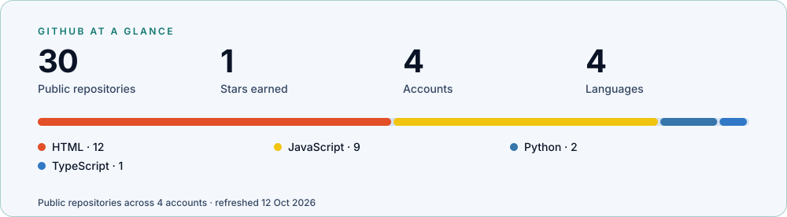
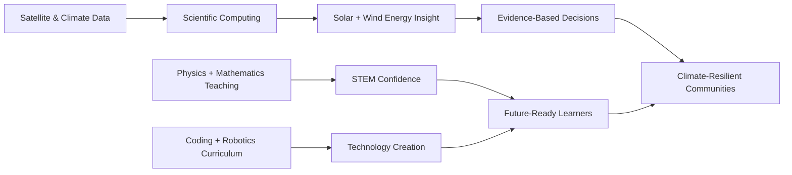

<a href="https://babatundeawo.github.io/">
  <picture>
    <source media="(prefers-color-scheme: dark)" srcset="assets/banner-dark.svg">
    
  </picture>
</a>

<picture>
  <source media="(prefers-color-scheme: dark)" srcset="assets/tagline-dark.svg">
  
</picture>

**[Portfolio](https://babatundeawo.github.io/)** · **[Email](mailto:babatundeawoyemi91@gmail.com)** · **[LinkedIn](https://www.linkedin.com/in/ba-awoyemi/)** · **[X](https://x.com/ba_awoyemi)** · **[Facebook](https://web.facebook.com/ba.awoyemi)** · **[Instagram](https://www.instagram.com/ba_awoyemi/)** · **[Threads](https://www.threads.net/@ba_awoyemi)**

Based in Nigeria · Focus on climate science and STEM education · Open to research and STEM partnerships

[About](#about) · [Education](#education) · [Research](#research) · [Experience](#experience) · [Recognition](#certifications-and-recognition) · [Skills](#skills) · [Collaborate](#collaboration) · [Projects](#projects) · [Connect](#connect)

---

## About

**Babatunde Ayoola Awoyemi** is a Nigerian atmospheric physicist, STEM educator, EdTech consultant, coding and robotics trainer, and climate-energy researcher.

He works between two worlds: atmospheric physics and climate research on one side, STEM education and technology training on the other. He turns satellite datasets and scientific method into research insight, and into clear, hands-on learning systems for schools and learners.

> Serve society through STEM education, climate research and practical technology empowerment.

<table>
  <tr>
    <th align="left">Climate</th>
    <th align="left">Teaching</th>
    <th align="left">EdTech</th>
    <th align="left">Research</th>
  </tr>
  <tr valign="top">
    <td>Solar radiation, atmospheric modelling, remote sensing and renewable energy assessment.</td>
    <td>Physics, Mathematics, ICT, learner-centered pedagogy and visual scientific explanation.</td>
    <td>Python, Scratch, robotics, coding clubs, curriculum design and STEM program delivery.</td>
    <td>Satellite datasets, all-sky irradiance, Weibull wind modelling and tropical climate systems.</td>
  </tr>
</table>

### At a glance

| | |
| --- | --- |
| **Identity** | Atmospheric Physicist · STEM Educator · EdTech Consultant · Climate and Renewable Energy Researcher · Coding, Robotics and ICT Trainer · AI Prompt Engineering and Practical AI Usage Advocate |
| **Current roles** | Physics Instructor / STEM Educator, Oyo State TESCOM · Lead Consultant, Knowledge Base International Schools · Lead Consultant, Techbase Consulting Services · Programs Associate, STEM for Development |
| **Academic path** | B.Sc. Physics, University of Ibadan, 2014 · M.Sc. Physics (Atmospheric Physics), University of Ibadan |
| **Research focus** | Advanced solar radiation modelling across tropical regions · Satellite-derived direct irradiance under all-sky conditions · Wind speed distribution and wind energy potential in Nigeria · Climate dynamics, remote sensing and energy-environment systems |
| **Teaching stack** | Physics · Mathematics · ICT · Python · Scratch · Web development · Robotics · AI prompt engineering · Practical AI usage |

---

## Education

| Stage | Institution | Years / Date | Highlights |
| --- | --- | --- | --- |
| **Primary Education** | Ronk New Age Nursery and Primary School, Oyo State | 1994–2002 | Built early habits of diligence, sportsmanship and academic curiosity. |
| **Secondary Education** | Federal Government College, Ogbomoso | 2002–2008 | Boarding-school formation that built resilience, independence and practical life skills. |
| **B.Sc. Physics** | University of Ibadan | 2009–2014 | Transformed an earlier dislike for Physics into university-level strength. |
| **M.Sc. Physics — Atmospheric Physics** | University of Ibadan | Completed March 2019 | Focused on solar irradiance estimation and atmospheric datasets. |

---

## Research

| Theme | Methods and tools | Output / status |
| --- | --- | --- |
| Solar dynamics | Solar structure, variability analysis, space-weather context | ICRERA-prepared manuscript under review |
| All-sky direct irradiance | Satellite datasets, cloud transmittance, atmospheric parameters | Published in *Bulletin of the Science Association of Nigeria* (2020) |
| Wind energy potential | Weibull distribution, statistical wind-speed analysis | Published in *Journal of Science and Technology* (2022) |

<strong>Investigating Solar Dynamics: Unveiling the Intricacies of Solar Structure and Variability</strong>

 

**Undergraduate project · University of Ibadan**
**Publication status:** Prepared for / under review by the International Conference on Renewable Energy Research and Applications (ICRERA).

- Explored solar structure, variability and the wider implications of solar dynamics.
- Built an early research foundation in physics-based modelling and renewable-energy relevance.
- Strengthened interest in climate-energy systems and scientific communication.

<strong>Parametric Estimation of Direct Irradiance under All-Sky Conditions from Publicly Available Satellite Datasets</strong>

 

**M.Sc. project · University of Ibadan · Published 2020**
**Publication:** *Bulletin of the Science Association of Nigeria*.

- Developed a practical approach for estimating direct irradiance under all-sky atmospheric conditions.
- Used publicly available satellite datasets to address limited ground-measurement coverage.
- Contributed to solar-resource assessment for data-scarce tropical and developing regions.
- Connected atmospheric physics with renewable energy planning and climate-informed decision-making.

<strong>Statistical Analysis of Wind Speed Distribution and Wind Energy Potential in Nigeria Using the Weibull Distribution Model</strong>

 

**Wind energy research · Published 2022**
**Publication:** *Journal of Science and Technology*; further prepared for the *International Journal of Energy and Environmental Engineering*.

- Modelled wind-speed distributions using Weibull-based statistical methods.
- Assessed wind-energy potential across Nigerian contexts.
- Supported renewable energy feasibility analysis using data-driven atmospheric insight.

---

## Experience

### Current

**STEM for Development (SFD) — Programs Associate**
February 2026 – Present · Strategic Programs Unit, Office of Strategic Initiatives (volunteer)

- Support strategic programmatic tasks, ensuring clarity, accuracy and alignment with SFD's mission and goals.
- Contribute reliably to agreed-upon hours and responsibilities across the Strategic Programs Unit.
- Collaborate professionally across a distributed, international team.

**Oyo State Post Primary Teaching Service Commission — Physics Instructor / STEM Educator**
January 2025 – Present

- Teach Physics, Mathematics and ICT at the secondary-school level.
- Translate scientific concepts into practical explanations, visual demonstrations and learner-centered activities.
- Support students with STEM confidence, problem-solving habits and digital-literacy foundations.

**[Knowledge Base International Schools](https://kbischools.com.ng) — Lead Consultant**
January 2022 – Present · Oyo State

- Serve as lead consultant for STEM, ICT, coding and robotics learning pathways.
- Support school leadership with technology-enabled learning strategy, teacher guidance and student project development.
- Help learners build confidence through practical, project-based digital-skills experiences.

**[Techbase Consulting Services](https://techbasengr.com.ng) — Lead Consultant**
January 2022 – Present · Registered STEM education and consultancy business

- Lead a consultancy focused on STEM education, coding, robotics, school support and technology-enabled learning.
- Design learning experiences in Python, Scratch, HTML, CSS, JavaScript, robotics and physical computing.
- Provide schools with STEM program strategy, curriculum development, teacher support and learner project pathways.

### Earlier

<strong>Techbridge Consulting Limited — Head of Training and Programs</strong> · 2017–2022

 

- Directed robotics, coding and digital-skills programs for learners and institutions.
- Developed curricula for Python, Scratch and web development.
- Led training systems that strengthened company growth, learner reach and program delivery outcomes.
- Built program structures connecting creativity, computation and measurable learning outcomes.

<strong>Federal Government NTeach Programme — Physics and ICT Instructor</strong> · 2016–2019

 

- Delivered secondary-level Physics and ICT instruction through the Federal Government's NTeach initiative.
- Supported learners with structured explanations, classroom technology and practical science engagement.

<strong>International Institute of Tropical Agriculture — Data Analyst</strong> · 2015–2016

 

- Analysed agricultural and climate-related datasets using SPSS.
- Supported reports connected to climate resilience and agricultural development in West Africa.
- Strengthened applied data-analysis experience in development, food systems and climate contexts.

<strong>National Youth Service Corps — Teacher and Fellowship President</strong> · 2014–2015 · Akwa Ibom State

 

- Awarded a certificate of recognition for exemplary work.
- Served as president of a corps fellowship group during service.
- Managed housing coordination, interpersonal conflict resolution and service leadership for fellow corps members.

---

## Certifications and recognition

**Leadership and impact**

- **STEM for Development** — selected as Programs Associate.
- **YALI RLC West Africa** — Leadership Certification, 2024/2025.
- **LEAP Africa** — volunteer certification for SDG-focused community projects, August 2021.
- **Healing Lives Initiative** — certificate of appreciation for supporting Rise Conference 1.0, July 2024.

**Design thinking**

- **Australian Computing Academy** — Certificate of Mastery, DT Mini Challenge: Space Invaders with Blockly.
- **Cartedo** — Design Thinking Certification: COVID-19 Response.
- **Unilever Level-Up 2.0** — Design Thinking from a Business Perspective, January 2025.

**Web, ICT and creative technology**

- **Coursera** — Build a Full Website using WordPress, February 2021.
- **Coursera / University of Michigan** — Introduction to HTML5, February 2021.
- **SoloLearn** — HTML, CSS, Coding Foundations and Tech for Everyone, 2020–2024.
- **LinkedIn Learning** — What is Graphic Design?, August 2021.
- **Hour of Code** — Certificate of Completion.

---

## Skills

**Scientific computing, climate and data**
`Python` `Fortran` `SPSS` `Remote sensing` `Atmospheric modelling` `Climate modelling` `Wind energy statistics (Weibull)`

**Web, coding and digital learning**
`HTML5` `CSS3` `JavaScript` `Git and GitHub` `Jekyll / GitHub Pages` `Firebase` `Scratch` `WordPress` `ICT training` `AI prompt engineering` `Practical AI usage`

**Robotics, program design and teaching**
`Robotics` `micro:bit` `Curriculum design` `STEM education` `Teacher training` `Data analysis`

---

## Collaboration

Open to research support, speaking engagements, STEM partnerships, school programs, curriculum collaborations and community-impact projects.

<table>
  <tr>
    <th align="left" width="50%">Climate, solar and energy research</th>
    <th align="left" width="50%">STEM, coding and robotics education</th>
  </tr>
  <tr valign="top">
    <td>
      <ul>
        <li>Solar radiation and direct irradiance modelling</li>
        <li>Remote-sensing workflows for data-scarce regions</li>
        <li>Wind-energy potential studies using statistical distributions</li>
        <li>Climate dynamics and tropical atmospheric modelling</li>
        <li>Research proposal development and literature synthesis</li>
      </ul>
    </td>
    <td>
      <ul>
        <li>Physics, Mathematics and ICT intervention programs</li>
        <li>Scratch, Python, HTML/CSS and beginner JavaScript curricula</li>
        <li>AI prompt engineering and responsible practical AI usage for learning workflows</li>
        <li>Robotics clubs, school STEM labs and project showcases</li>
        <li>Teacher training and institutional STEM strategy</li>
        <li>Digital-skills bootcamps for learners and communities</li>
      </ul>
    </td>
  </tr>
</table>

---

## Projects

Public repositories across my personal account and the three organisations I build under, grouped by account. The full portfolio lives at [babatundeawo.github.io](https://babatundeawo.github.io/).

### Personal — [babatundeawo](https://github.com/babatundeawo)

| Project | What it is | Links |
| --- | --- | --- |
| **Portfolio site** | This profile's full portfolio: about, education, research, experience and projects. | [Live](https://babatundeawo.github.io/) · [Code](https://github.com/babatundeawo/babatundeawo.github.io) |
| **Global Warming Explorer** | Multi-page interactive climate-science learning site with a guided course and classroom check-in dashboard. | [Live](https://babatundeawo.github.io/globalwarming/) · [Code](https://github.com/babatundeawo/globalwarming) |
| **PromptOS — AI Prompt Library** | Curated AI prompts across multiple categories, searchable and editable, works offline. | [Live](https://babatundeawo.github.io/ai-prompt-library/) · [Code](https://github.com/babatundeawo/ai-prompt-library) |
| **Deploybase — AI Deployment Directory** | Registry of every deployed Claude Project built and run by Techbase / Babatunde Awoyemi. | [Live](https://babatundeawo.github.io/deploybase/) · [Code](https://github.com/babatundeawo/deploybase) |
| **Educator AI Toolkit** | Free reference site for Nigerian educators with exam, marking-guide and lesson-note AI generators. | [Live](https://babatundeawo.github.io/educator-ai-toolkit/) · [Code](https://github.com/babatundeawo/educator-ai-toolkit) |
| **AI Studio → Android Deployment Guide** | Step-by-step guide to shipping a Google AI Studio app as an installable Android PWA. | [Live](https://babatundeawo.github.io/ai-studio-android-guide/) · [Code](https://github.com/babatundeawo/ai-studio-android-guide) |
| **Personal AI Career Engine** | Free guide to building CV and career documents with NotebookLM and a configured Claude Project. | [Live](https://babatundeawo.github.io/career-engine-guide/) · [Code](https://github.com/babatundeawo/career-engine-guide) |
| **Deep Calls** | Long-form Christian apologetics essays, served from a custom Python static-site generator. | [Live](https://babatundeawo.github.io/deep-calls/) · [Code](https://github.com/babatundeawo/deep-calls) |
| **RCCG Training Portal** | Interactive, mobile-first discipleship training portal replacing three printed RCCG manuals (Believers', Baptismal, Workers-in-Training) with guided lessons, scripture-reveal quizzes and progress sync. | [Live](https://babatundeawo.github.io/rccg-training-portal/) · [Code](https://github.com/babatundeawo/rccg-training-portal) |
| **Akinyele Spelling Challenge** | Fully responsive static microsite documenting the 2026 Akinyele Spelling Challenge: event details, schools and results. | [Live](https://babatundeawo.github.io/akinyele-spelling-challenge/) · [Code](https://github.com/babatundeawo/akinyele-spelling-challenge) |
| **Millionaire Mindset** | Personal-development app on wealth-building habits and mindset shifts. | [Live](https://babatundeawo.github.io/Millionaire-Mindset/) · [Replit](https://millionaire-mindset--ba-awoyemi.replit.app/) · [Code](https://github.com/babatundeawo/Millionaire-Mindset) |
| **Personal Projects (monorepo)** | Smaller personal builds and coursework in one repository: a calculator, a regex-teaching playground, a student report-card system and AI agent-building exercises. No live site. | [Code](https://github.com/babatundeawo/personal-projects) |
| **Timekeeper** | Installable (PWA) clock, countdown, stopwatch, pomodoro and alarms utility. | [Live](https://babatundeawo.github.io/timekeeper/) · [Code](https://github.com/babatundeawo/timekeeper) |
| **Class Scoresheet** | Teacher scoresheet with classes, student lists, CA / open-day / exam marks with bonus marks, grades, positions, printable report cards and Excel export. Per-teacher sign-in, works offline. | [Live](https://babatundeawo.github.io/scoresheet/) · [Code](https://github.com/babatundeawo/scoresheet) |
| **Naija Monopoly** | Nigeria-themed Monopoly desktop game, built with Electron and packaged as a Windows installer via GitHub Actions. | [Releases](https://github.com/babatundeawo/naija-monopoly/releases) · [Code](https://github.com/babatundeawo/naija-monopoly) |

### Techbase Consultant Services — [techbaseng](https://github.com/techbaseng)

| Project | What it is | Links |
| --- | --- | --- |
| **Techbase STEM Academy (hub)** | Course index and landing page for all six free courses. | [Live](https://techbaseng.github.io/) · [Code](https://github.com/techbaseng/techbaseng.github.io) |
| **HTML Fundamentals** | Beginner course. | [Live](https://techbaseng.github.io/techbase-html/) · [Code](https://github.com/techbaseng/techbase-html) |
| **CSS Styling** | Beginner to advanced course. | [Live](https://techbaseng.github.io/techbase-css/) · [Code](https://github.com/techbaseng/techbase-css) |
| **JavaScript** | Intermediate course. | [Live](https://techbaseng.github.io/techbase-js/) · [Code](https://github.com/techbaseng/techbase-js) |
| **Python Programming** | Beginner to advanced course. | [Live](https://techbaseng.github.io/techbase-python/) · [Code](https://github.com/techbaseng/techbase-python) |
| **Scratch Programming** | Beginner course. | [Live](https://techbaseng.github.io/techbase-scratch/) · [Code](https://github.com/techbaseng/techbase-scratch) |
| **Robotics and micro:bit** | Official BBC micro:bit projects, beginner to advanced (Stage 1). | [Live](https://techbaseng.github.io/techbase-robotics/) · [Code](https://github.com/techbaseng/techbase-robotics) |
| **Practical Robotics** | Hands-on hardware course, Stage 2: sensors, actuators and advanced modules with the Freenove kit. | [Live](https://techbaseng.github.io/techbase-practical-robotics/) · [Code](https://github.com/techbaseng/techbase-practical-robotics) |

### Knowledge Base International Schools — [kbischool](https://github.com/kbischool)

| Project | What it is | Links |
| --- | --- | --- |
| **KBI Schools website** | Public website for Knowledge Base International Schools: admissions, academics, facilities and news. | [Live](https://kbischool.github.io/) · [Code](https://github.com/kbischool/kbischool.github.io) |

### RCCG Kingdom Diplomats Youth Church — [rccgkd](https://github.com/rccgkd)

| Project | What it is | Links |
| --- | --- | --- |
| **Bible Trivia Game** | Interactive Bible trivia game for church events, live scoring, no install needed. | [Live](https://rccgkd.github.io/bible-trivia-game/) · [Code](https://github.com/rccgkd/bible-trivia-game) |
| **Bible Family Feud** | Interactive Bible-themed Family Feud game show for church events: dozens of rounds, live scoring, no install needed. | [Live](https://rccgkd.github.io/bible-family-feud/) · [Code](https://github.com/rccgkd/bible-family-feud) |

Each account's own About page is rendered from its profile repository: [babatundeawo/babatundeawo](https://github.com/babatundeawo/babatundeawo), [techbaseng/.github](https://github.com/techbaseng/.github) and [kbischool/.github](https://github.com/kbischool/.github).

---

## GitHub at a glance

  <picture>
    <source media="(prefers-color-scheme: dark)" srcset="assets/stats-dark.svg">
    
  </picture>

---

## How the work fits together

I help students, schools and institutions turn scientific curiosity into practical capability, connecting climate research, STEM education, coding, robotics and community-focused service for a more informed and resilient society.

---

## Connect

| Channel | Link |
| --- | --- |
| Email | <babatundeawoyemi91@gmail.com> |
| GitHub | [babatundeawo](https://github.com/babatundeawo) |
| LinkedIn | [ba-awoyemi](https://www.linkedin.com/in/ba-awoyemi/) |
| X | [@ba_awoyemi](https://x.com/ba_awoyemi) |
| Facebook | [ba.awoyemi](https://web.facebook.com/ba.awoyemi) |
| Instagram | [@ba_awoyemi](https://www.instagram.com/ba_awoyemi/) |
| Threads | [@ba_awoyemi](https://www.threads.net/@ba_awoyemi) |
| Portfolio | [babatundeawo.github.io](https://babatundeawo.github.io/) |

---

*"What ultimately matters is not where you end up relative to others, but where you end up relative to yourself when you began."*

Built around service, scientific curiosity, disciplined learning and practical STEM impact.

