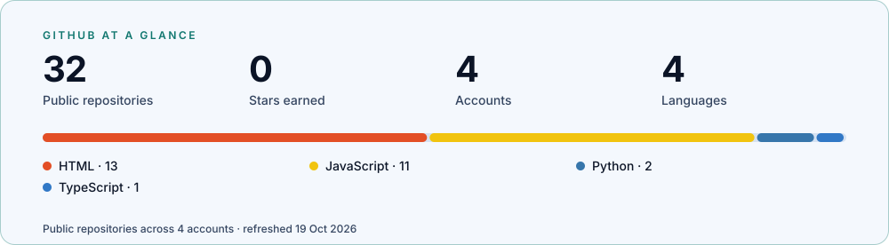
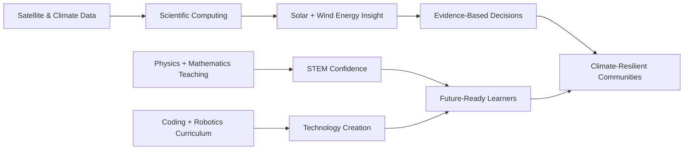

<a href="https://babatundeawo.github.io/">
  <picture>
    <source media="(prefers-color-scheme: dark)" srcset="assets/banner-dark.svg">
    
  </picture>
</a>

<picture>
  <source media="(prefers-color-scheme: dark)" srcset="assets/tagline-dark.svg">
  
</picture>

**[Portfolio](https://babatundeawo.github.io/)** · **[Email](mailto:babatundeawoyemi91@gmail.com)** · **[LinkedIn](https://www.linkedin.com/in/ba-awoyemi/)** · **[X](https://x.com/ba_awoyemi)** · **[Facebook](https://web.facebook.com/ba.awoyemi)** · **[Instagram](https://www.instagram.com/ba_awoyemi/)** · **[Threads](https://www.threads.net/@ba_awoyemi)**

Based in Nigeria · Focus on climate science and STEM education · Open to research and STEM partnerships

[About](#about) · [Education](#education) · [Research](#research) · [Experience](#experience) · [Recognition](#certifications-and-recognition) · [Skills](#skills) · [Collaborate](#collaboration) · [Projects](#projects) · [Connect](#connect)

---

## About

**Babatunde Ayoola Awoyemi** is a Nigerian atmospheric physicist, STEM educator, EdTech consultant, coding and robotics trainer, and climate-energy researcher, based in Oyo State.

His research turns satellite datasets into solar-energy and wind-energy insight for tropical regions. His teaching and consulting turn the same scientific method into clear, hands-on learning for schools and learners. Alongside both, he builds the software that schools and communities use day to day: learning sites, attendance and records systems, fee portals, and event games. Each project below links to its live site and its source code.

> Serve society through STEM education, climate research and practical technology empowerment.

<table>
  <tr>
    <th align="left">Climate</th>
    <th align="left">Teaching</th>
    <th align="left">EdTech</th>
    <th align="left">Research</th>
  </tr>
  <tr valign="top">
    <td>Solar radiation, atmospheric modelling, remote sensing and renewable energy assessment.</td>
    <td>Physics, Mathematics, ICT, learner-centered pedagogy and visual scientific explanation.</td>
    <td>Python, Scratch, robotics, coding clubs, curriculum design and STEM program delivery.</td>
    <td>Satellite datasets, all-sky irradiance, Weibull wind modelling and tropical climate systems.</td>
  </tr>
</table>

### At a glance

| | |
| --- | --- |
| **Identity** | Atmospheric Physicist · STEM Educator · EdTech Consultant · Climate and Renewable Energy Researcher · Coding, Robotics and ICT Trainer · AI Prompt Engineering and Practical AI Usage Advocate |
| **Current roles** | Physics Instructor / STEM Educator, Oyo State TESCOM · Lead Consultant, Knowledge Base International Schools · Lead Consultant, Techbase Consulting Services · Programs Associate, STEM for Development |
| **Academic path** | B.Sc. Physics, University of Ibadan, 2014 · M.Sc. Physics (Atmospheric Physics), University of Ibadan |
| **Research focus** | Advanced solar radiation modelling across tropical regions · Satellite-derived direct irradiance under all-sky conditions · Wind speed distribution and wind energy potential in Nigeria · Climate dynamics, remote sensing and energy-environment systems |
| **Teaching stack** | Physics · Mathematics · ICT · Python · Scratch · Web development · Robotics · AI prompt engineering · Practical AI usage |

---

## Education

| Stage | Institution | Years / Date | Highlights |
| --- | --- | --- | --- |
| **Primary Education** | Ronk New Age Nursery and Primary School, Oyo State | 1994–2002 | Built early habits of diligence, sportsmanship and academic curiosity. |
| **Secondary Education** | Federal Government College, Ogbomoso | 2002–2008 | Boarding-school formation that built resilience, independence and practical life skills. |
| **B.Sc. Physics** | University of Ibadan | 2009–2014 | Transformed an earlier dislike for Physics into university-level strength. |
| **M.Sc. Physics — Atmospheric Physics** | University of Ibadan | Completed March 2019 | Focused on solar irradiance estimation and atmospheric datasets. |

---

## Research

| Theme | Methods and tools | Output / status |
| --- | --- | --- |
| Solar dynamics | Solar structure, variability analysis, space-weather context | ICRERA-prepared manuscript under review |
| All-sky direct irradiance | Satellite datasets, cloud transmittance, atmospheric parameters | Published in *Bulletin of the Science Association of Nigeria* (2020) |
| Wind energy potential | Weibull distribution, statistical wind-speed analysis | Published in *Journal of Science and Technology* (2022) |

<strong>Investigating Solar Dynamics: Unveiling the Intricacies of Solar Structure and Variability</strong>

 

**Undergraduate project · University of Ibadan**
**Publication status:** Prepared for / under review by the International Conference on Renewable Energy Research and Applications (ICRERA).

- Explored solar structure, variability and the wider implications of solar dynamics.
- Built an early research foundation in physics-based modelling and renewable-energy relevance.
- Strengthened interest in climate-energy systems and scientific communication.

<strong>Parametric Estimation of Direct Irradiance under All-Sky Conditions from Publicly Available Satellite Datasets</strong>

 

**M.Sc. project · University of Ibadan · Published 2020**
**Publication:** *Bulletin of the Science Association of Nigeria*.

- Developed a practical approach for estimating direct irradiance under all-sky atmospheric conditions.
- Used publicly available satellite datasets to address limited ground-measurement coverage.
- Contributed to solar-resource assessment for data-scarce tropical and developing regions.
- Connected atmospheric physics with renewable energy planning and climate-informed decision-making.

<strong>Statistical Analysis of Wind Speed Distribution and Wind Energy Potential in Nigeria Using the Weibull Distribution Model</strong>

 

**Wind energy research · Published 2022**
**Publication:** *Journal of Science and Technology*; further prepared for the *International Journal of Energy and Environmental Engineering*.

- Modelled wind-speed distributions using Weibull-based statistical methods.
- Assessed wind-energy potential across Nigerian contexts.
- Supported renewable energy feasibility analysis using data-driven atmospheric insight.

---

## Experience

### Current

**STEM for Development (SFD) — Programs Associate**
February 2026 – Present · Strategic Programs Unit, Office of Strategic Initiatives (volunteer)

- Support strategic programmatic tasks, ensuring clarity, accuracy and alignment with SFD's mission and goals.
- Contribute reliably to agreed-upon hours and responsibilities across the Strategic Programs Unit.
- Collaborate professionally across a distributed, international team.

**Oyo State Post Primary Teaching Service Commission — Physics Instructor / STEM Educator**
January 2025 – Present

- Teach Physics, Mathematics and ICT at the secondary-school level.
- Translate scientific concepts into practical explanations, visual demonstrations and learner-centered activities.
- Support students with STEM confidence, problem-solving habits and digital-literacy foundations.

**[Knowledge Base International Schools](https://kbischools.com.ng) — Lead Consultant**
January 2022 – Present · Oyo State

- Serve as lead consultant for STEM, ICT, coding and robotics learning pathways.
- Support school leadership with technology-enabled learning strategy, teacher guidance and student project development.
- Help learners build confidence through practical, project-based digital-skills experiences.

**[Techbase Consulting Services](https://techbasengr.com.ng) — Lead Consultant**
January 2022 – Present · Registered STEM education and consultancy business

- Lead a consultancy focused on STEM education, coding, robotics, school support and technology-enabled learning.
- Design learning experiences in Python, Scratch, HTML, CSS, JavaScript, robotics and physical computing.
- Provide schools with STEM program strategy, curriculum development, teacher support and learner project pathways.

### Earlier

<strong>Techbridge Consulting Limited — Head of Training and Programs</strong> · 2017–2022

 

- Directed robotics, coding and digital-skills programs for learners and institutions.
- Developed curricula for Python, Scratch and web development.
- Led training systems that strengthened company growth, learner reach and program delivery outcomes.
- Built program structures connecting creativity, computation and measurable learning outcomes.

<strong>Federal Government NTeach Programme — Physics and ICT Instructor</strong> · 2016–2019

 

- Delivered secondary-level Physics and ICT instruction through the Federal Government's NTeach initiative.
- Supported learners with structured explanations, classroom technology and practical science engagement.

<strong>International Institute of Tropical Agriculture — Data Analyst</strong> · 2015–2016

 

- Analysed agricultural and climate-related datasets using SPSS.
- Supported reports connected to climate resilience and agricultural development in West Africa.
- Strengthened applied data-analysis experience in development, food systems and climate contexts.

<strong>National Youth Service Corps — Teacher and Fellowship President</strong> · 2014–2015 · Akwa Ibom State

 

- Awarded a certificate of recognition for exemplary work.
- Served as president of a corps fellowship group during service.
- Managed housing coordination, interpersonal conflict resolution and service leadership for fellow corps members.

---

## Certifications and recognition

**Leadership and impact**

- **STEM for Development** — selected as Programs Associate.
- **YALI RLC West Africa** — Leadership Certification, 2024/2025.
- **LEAP Africa** — volunteer certification for SDG-focused community projects, August 2021.
- **Healing Lives Initiative** — certificate of appreciation for supporting Rise Conference 1.0, July 2024.

**Design thinking**

- **Australian Computing Academy** — Certificate of Mastery, DT Mini Challenge: Space Invaders with Blockly.
- **Cartedo** — Design Thinking Certification: COVID-19 Response.
- **Unilever Level-Up 2.0** — Design Thinking from a Business Perspective, January 2025.

**Web, ICT and creative technology**

- **Coursera** — Build a Full Website using WordPress, February 2021.
- **Coursera / University of Michigan** — Introduction to HTML5, February 2021.
- **SoloLearn** — HTML, CSS, Coding Foundations and Tech for Everyone, 2020–2024.
- **LinkedIn Learning** — What is Graphic Design?, August 2021.
- **Hour of Code** — Certificate of Completion.

---

## Skills

**Scientific computing, climate and data**
`Python` `Fortran` `SPSS` `Remote sensing` `Atmospheric modelling` `Climate modelling` `Wind energy statistics (Weibull)`

**Web, coding and digital learning**
`HTML5` `CSS3` `JavaScript` `Git and GitHub` `Jekyll / GitHub Pages` `Firebase` `Scratch` `WordPress` `ICT training` `AI prompt engineering` `Practical AI usage`

**Robotics, program design and teaching**
`Robotics` `micro:bit` `Curriculum design` `STEM education` `Teacher training` `Data analysis`

---

## Collaboration

Open to research support, speaking engagements, STEM partnerships, school programs, curriculum collaborations and community-impact projects.

<table>
  <tr>
    <th align="left" width="50%">Climate, solar and energy research</th>
    <th align="left" width="50%">STEM, coding and robotics education</th>
  </tr>
  <tr valign="top">
    <td>
      <ul>
        <li>Solar radiation and direct irradiance modelling</li>
        <li>Remote-sensing workflows for data-scarce regions</li>
        <li>Wind-energy potential studies using statistical distributions</li>
        <li>Climate dynamics and tropical atmospheric modelling</li>
        <li>Research proposal development and literature synthesis</li>
      </ul>
    </td>
    <td>
      <ul>
        <li>Physics, Mathematics and ICT intervention programs</li>
        <li>Scratch, Python, HTML/CSS and beginner JavaScript curricula</li>
        <li>AI prompt engineering and responsible practical AI usage for learning workflows</li>
        <li>Robotics clubs, school STEM labs and project showcases</li>
        <li>Teacher training and institutional STEM strategy</li>
        <li>Digital-skills bootcamps for learners and communities</li>
      </ul>
    </td>
  </tr>
</table>

---

## Projects

28 projects across six GitHub accounts, ranked by my own judgement of how substantial each one is. Scope and engineering come first: real accounts and databases, access rules, offline support and the size of the codebase. Small starters come last. Apps marked "Open app" ask for a sign-in, and only approved users can go past it. The full portfolio, with search and filters, lives at [babatundeawo.github.io/projects.html](https://babatundeawo.github.io/projects.html).

Accounts: [babatundeawo](https://github.com/babatundeawo) (personal) · [kbischool](https://github.com/kbischool) · [techbaseng](https://github.com/techbaseng) · [rccgkd](https://github.com/rccgkd) · [termbook](https://github.com/termbook) · [agrictool](https://github.com/agrictool)

### Flagship platforms

Full systems with accounts, databases and access rules, or large codebases with real users in mind.

| # | Project | Account | What it does | Links |
| --- | --- | --- | --- | --- |
| 1 | **School Fee Payment Portal** | Knowledge Base Schools | Fee and school-information portal for Knowledge Base International Schools. Parents see itemised fees and payments, staff see who has paid, and the owner sees the whole school's finances and runs data imports. Real accounts on Firebase. | [Open app](https://school-fee-portal-4f0e6.web.app/) · [Code](https://github.com/kbischool/school-fee-portal) |
| 2 | **Techbase STEM Academy** | Techbase | The Techbase Consultant Services website plus a free academy of 472 lessons across eight courses, built from source files by a Python pipeline. | [Live](https://techbaseng.github.io/) · [Code](https://github.com/techbaseng/techbaseng.github.io) |
| 3 | **Termbook** | Termbook | Free daily AM/PM attendance registers, per-subject score sheets and term report cards for Nigerian secondary schools. Admins, teachers and parents each see only what their role allows. Installs on a phone and works offline. | [Live](https://termbook.github.io/) · [Code](https://github.com/termbook/termbook.github.io) |
| 4 | **RAISSAT Digital Food Systems Platform** | Agrictool | Web platform for the RAISSAT digital food systems community project at FUTA, Akure: participant registration, pre and post assessments, certificates, a searchable toolkit directory and an administrator dashboard. | [Live](https://agrictool.github.io/) · [Code](https://github.com/agrictool/agrictool.github.io) |
| 5 | **Naija Monopoly** | Personal | A Nigeria-themed Monopoly with the full official rules. Play it in the browser, or install the Windows desktop version built with Electron. | [Live](https://babatundeawo.github.io/naija-monopoly/) · [Code](https://github.com/babatundeawo/naija-monopoly) |
| 6 | **Millionaire Mindset** | Personal | A free quiz game in the browser: climb a 15-step prize ladder, use three lifelines, and choose between risking it and walking away. | [Live](https://babatundeawo.github.io/Millionaire-Mindset/) · [Code](https://github.com/babatundeawo/Millionaire-Mindset) |
| 7 | **ISCGS Register** | Personal | Register of students, staff and records for Ilado-Sagbo Community Grammar School: student roll, staff directory, attendance and assessment coverage, school profile and inventory. Only staff approved by an administrator can sign in. | [Open app](https://babatundeawo.github.io/ilado-school-dashboard/) · [Code](https://github.com/babatundeawo/ilado-school-dashboard) |
| 8 | **RCCG Training Portal** | Personal | Mobile-first study portal that replaces three printed RCCG manuals (Believers', Baptismal and Workers-in-Training) with guided lessons, scripture that opens in place, class tests, notes, bookmarks and optional synced progress. | [Live](https://babatundeawo.github.io/rccg-training-portal/) · [Code](https://github.com/babatundeawo/rccg-training-portal) |

### Complete products

Finished apps and sites with their own features, data and offline support.

| # | Project | Account | What it does | Links |
| --- | --- | --- | --- | --- |
| 9 | **QuizMaster** | Personal | A quiz game with 400 questions, difficulty levels, a countdown timer and an online leaderboard. Players can also write their own questions. | [Live](https://babatundeawo.github.io/quizmaster/) · [Code](https://github.com/babatundeawo/quizmaster) |
| 10 | **Global Warming Explorer** | Personal | Interactive climate-science course with a footprint calculator, charts, quizzes, certificates and a classroom check-in dashboard. Written from a background in atmospheric physics. | [Live](https://babatundeawo.github.io/globalwarming/) · [Code](https://github.com/babatundeawo/globalwarming) |
| 11 | **Kingdom Quiz (Bible Trivia)** | RCCG Kingdom Diplomats | Host-led Bible trivia for church game nights. One person hosts on the big screen, up to four players take turns, and the audience joins from their phones with a four-letter code. | [Live](https://rccgkd.github.io/bible-trivia-game/) · [Code](https://github.com/rccgkd/bible-trivia-game) |
| 12 | **Attendance Register** | Personal | Daily AM/PM attendance register for teachers, with weekly and term reports, student records, a holiday calendar and CSV export. Shared through Firebase and usable offline. | [Open app](https://babatundeawo.github.io/attendance/) · [Code](https://github.com/babatundeawo/attendance) |
| 13 | **Deploybase** | Personal | A directory of configured Claude Projects, each with its working page and the exact instructions behind it. | [Live](https://babatundeawo.github.io/deploybase/) · [Code](https://github.com/babatundeawo/deploybase) |
| 14 | **Bible Family Feud** | RCCG Kingdom Diplomats | Family Feud-style Bible quiz for church events. Two teams guess the most popular answers while a host flips tiles and calls strikes from one screen. No install, no account, no server. | [Live](https://rccgkd.github.io/bible-family-feud/) · [Code](https://github.com/rccgkd/bible-family-feud) |
| 15 | **Daily Greetings** | Personal | Writes warm, prayerful WhatsApp greetings that fit the day and time, different for every contact. Review one, tap once, and WhatsApp opens ready to send. Keeps track of who you have greeted. | [Open app](https://babatundeawo.github.io/wa-greetings/) · [Code](https://github.com/babatundeawo/wa-greetings) |
| 16 | **PromptOS** | Personal | Over 200 working AI prompts for image generation, careers, social media, presentations and business. Fill in the blanks, copy, and go. Searchable, editable, and works offline. | [Live](https://babatundeawo.github.io/ai-prompt-library/) · [Code](https://github.com/babatundeawo/ai-prompt-library) |
| 17 | **Deep Calls** | Personal | Long-form Christian apologetics essays for people who ask hard questions, built from Markdown by a custom Python static-site generator. | [Live](https://babatundeawo.github.io/deep-calls/) · [Code](https://github.com/babatundeawo/deep-calls) |
| 18 | **Family Roots** | Personal | A private family tree with a story for each person, a timeline, search, and invite links that give relatives an editor or viewer role. Prints as an outline and backs up to a file. | [Open app](https://family-roots-3c16d.web.app/) · [Code](https://github.com/babatundeawo/family-roots) |
| 19 | **KBIS Records** | Knowledge Base Schools | Staff-only student records and fee accounts for KBIS Schools: student search, itemised fee accounts per term, fee structures and stock. Works offline and installs to the home screen. | [Open app](https://kbischool.github.io/kbis-records-app/) · [Code](https://github.com/kbischool/kbis-records-app) |

### Guides, sites and tools

Focused sites, guides and utilities, each doing one job well.

| # | Project | Account | What it does | Links |
| --- | --- | --- | --- | --- |
| 20 | **Educator AI Toolkit** | Personal | Guide for Nigerian teachers to set up one Claude Project that writes weekly lesson notes and exams with marking guides, plus 117 Scheme of Work files for JSS1 to SS3. | [Live](https://babatundeawo.github.io/educator-ai-toolkit/) · [Code](https://github.com/babatundeawo/educator-ai-toolkit) |
| 21 | **Akinyele Spelling Challenge** | Personal | Official site for the 2026 Akinyele Spelling Challenge in Ibadan: results, format, a large word bank, a practice trainer with a Spelling Bee game, and an event gallery. | [Live](https://babatundeawo.github.io/akinyele-spelling-challenge/) · [Code](https://github.com/babatundeawo/akinyele-spelling-challenge) |
| 22 | **Timekeeper** | Personal | Clock, countdown, stopwatch, focus timer and alarms in one quiet interface. Runs in the browser, stores nothing on a server, and works offline once installed. | [Live](https://babatundeawo.github.io/timekeeper/) · [Code](https://github.com/babatundeawo/timekeeper) |
| 23 | **Personal AI Career Engine** | Personal | Free four-phase guide to building a personal AI career engine with NotebookLM and a Claude Project, then generating CVs, cover letters and bios from your real history. | [Live](https://babatundeawo.github.io/career-engine-guide/) · [Code](https://github.com/babatundeawo/career-engine-guide) |
| 24 | **AI Studio to Android Guide** | Personal | Multi-page guide from Google AI Studio to GitHub to Vercel to an installable Android app, with troubleshooting, a glossary and a free-tier reference table. | [Live](https://babatundeawo.github.io/ai-studio-android-guide/) · [Code](https://github.com/babatundeawo/ai-studio-android-guide) |
| 25 | **Knowledge Base International Schools** | Knowledge Base Schools | Public website of Knowledge Base International Schools, Moniya, Ibadan: admissions, academics, facilities, ICT, alumni and news. | [Live](https://kbischool.github.io/) · [Code](https://github.com/kbischool/kbischool.github.io) |
| 26 | **Personal Projects** | Personal | A build log of small web and Python projects, with a searchable front page that links to each one. | [Live](https://babatundeawo.github.io/personal-projects/) · [Code](https://github.com/babatundeawo/personal-projects) |

### Class exercises

Small starter projects from teaching sessions. Code only, no live site.

| # | Project | Account | What it does | Links |
| --- | --- | --- | --- | --- |
| 27 | **QuizMaster (David's copy)** | Personal | Three-screen starter quiz (home, question, result) from a Techbase class session. | [Code](https://github.com/babatundeawo/quizmaster-David) |
| 28 | **QuizMaster (Ire's copy)** | Personal | Three-screen starter quiz (home, question, result) from a Techbase class session. | [Code](https://github.com/babatundeawo/quizmaster-Ire) |

The source of this portfolio is [babatundeawo/babatundeawo.github.io](https://github.com/babatundeawo/babatundeawo.github.io).

---

## GitHub at a glance

  <picture>
    <source media="(prefers-color-scheme: dark)" srcset="assets/stats-dark.svg">
    
  </picture>

---

## How the work fits together

I help students, schools and institutions turn scientific curiosity into practical capability, connecting climate research, STEM education, coding, robotics and community-focused service for a more informed and resilient society.

---

## Connect

| Channel | Link |
| --- | --- |
| Email | <babatundeawoyemi91@gmail.com> |
| GitHub | [babatundeawo](https://github.com/babatundeawo) |
| LinkedIn | [ba-awoyemi](https://www.linkedin.com/in/ba-awoyemi/) |
| X | [@ba_awoyemi](https://x.com/ba_awoyemi) |
| Facebook | [ba.awoyemi](https://web.facebook.com/ba.awoyemi) |
| Instagram | [@ba_awoyemi](https://www.instagram.com/ba_awoyemi/) |
| Threads | [@ba_awoyemi](https://www.threads.net/@ba_awoyemi) |
| Portfolio | [babatundeawo.github.io](https://babatundeawo.github.io/) |

---

*"What ultimately matters is not where you end up relative to others, but where you end up relative to yourself when you began."*

Built around service, scientific curiosity, disciplined learning and practical STEM impact.

